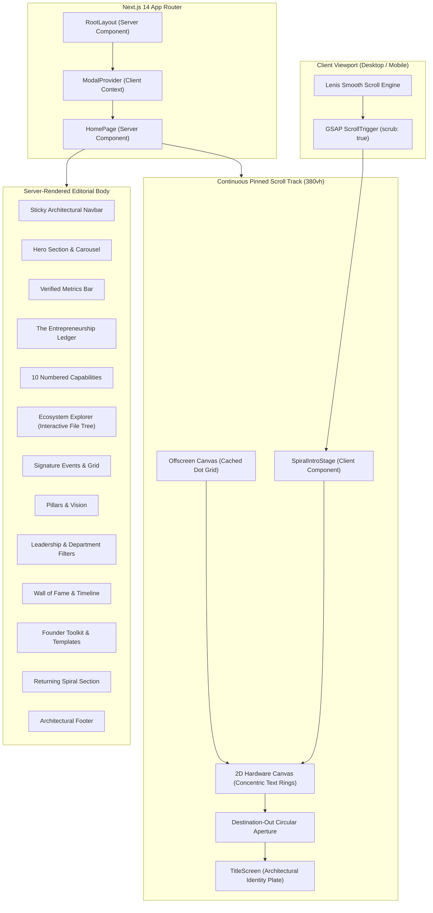

# E-Cell MITAOE — System Architecture & Component Model

## Overview

The E-Cell MITAOE platform is engineered as an **interactive entrepreneurship editorial experience**. It merges continuous scroll storytelling with high-performance React Server Components, client-side motion choreography, and zero-hydration static rendering.

---

## 1. System Architecture Diagram



---

## 2. Server Component vs Client Component Boundaries

To optimize Time to Interactive (TTI), First Contentful Paint (FCP), and eliminate client JavaScript bloat, component boundaries are strictly separated:

| Component | Type | Responsibility | Rationale |
| :--- | :--- | :--- | :--- |
| `src/app/layout.tsx` | Server Component | Root HTML, Google Font links, metadata | Static delivery, SEO tags |
| `src/app/page.tsx` | Server Component | Composition of all 14 homepage sections | Zero hydration overhead for static content |
| `src/components/modals/ModalContext.tsx` | Client Component | Global state for `EventModal`, `JoinModal`, `SearchModal` | Isolates interactive state without infecting page tree |
| `src/components/intro/SpiralIntroStage.tsx` | Client Component | 2D Canvas rendering, RAF loop, ScrollTrigger binding | Requires browser APIs (`window`, `canvas`, `requestAnimationFrame`) |
| `src/components/Navbar.tsx` | Client Component | Active link detection, search modal trigger, mobile drawer | Requires `usePathname()` and event listeners |
| `src/components/HeroSection.tsx` | Client Component | Carousel slider state, quick event modal triggering | Interactive slide switching |
| `src/components/explorer/EcosystemExplorer.tsx` | Client Component | File tree navigation, active file tab preview | Interactive simulated code explorer |
| `src/components/sections/LedgerSection.tsx` | Server Component | Timeline ledger tables, milestone rows | Pure markup, static HTML generation |
| `src/components/sections/FeaturesGrid.tsx` | Server Component | 10 numbered capability cards (001–010) | Pure markup, static HTML generation |
| `src/components/Footer.tsx` | Server Component | Navigation directory, copyright, institutional credits | Pure markup, zero JS |

---

## 3. Reversible Timeline Math & State Flow

The continuous scroll intro operates along normalized scroll progress $p \in [0.0, 1.0]$ across a pinned `380vh` track:

$$\text{Scroll Progress } p = \frac{\text{Current Scroll Y} - \text{Track Top}}{\text{Track Height} - \text{Viewport Height}}$$

```
p = 0.00 ──────── p = 0.25 ──────── p = 0.35 ──────── p = 0.88 ──────── p = 1.00
[ Split Hero ]    [ Glides to ]     [ Aperture ]      [ Full Screen ]   [ Exit to ]
[ Copy Left  ] ── [ Center    ] ──  [ Punches  ] ───  [ Underlying  ] ─ [ Homepage]
[ Spiral Right]   [ Rings Exp.]     [ Portal   ]      [ Site Reveal ]   [ Main    ]
```

### Stage Transitions:
1. **$0.00 \le p \le 0.25$ (Split Opening)**:
   - On desktop screens ($\ge 1024\text{px}$), center coordinates $cx = w \times 0.68$, $cy = h / 2$.
   - Left hero text overlay opacity is $1 - 3.8p$.
2. **$0.25 < p \le 0.35$ (Centering & Acceleration)**:
   - Center coordinates smoothly interpolate to $(w / 2, h / 2)$.
   - Typography rings accelerate rotation by factor $(1 + 1.2p)$.
3. **$0.35 < p \le 0.88$ (Aperture Lens Reveal)**:
   - Circular aperture radius:
     $$r(p) = \left(\frac{p - 0.35}{0.53}\right)^{2.1} \times R_{\text{max}}, \quad R_{\text{max}} = \frac{\sqrt{w^2 + h^2}}{2} + 100 \cdot \text{DPR}$$
   - Pixels inside $r(p)$ are cleared via `ctx.globalCompositeOperation = 'destination-out'`.
   - The underlying `TitleScreen` architectural plate is directly revealed through the opening.
4. **$0.88 < p \le 1.00$ (Full Reveal & Seamless Exit)**:
   - Aperture expands beyond viewport bounds.
   - Canvas opacity fades to $0$, and `pointer-events: none` is applied.
   - User naturally scrolls into `#homepage-main`.
5. **Upward Scrolling ($1.00 \to 0.00$)**:
   - Because progress $p$ is bound directly to ScrollTrigger, scrolling back up executes the mathematical inverse, smoothly contracting the aperture, returning the spiral rings, and restoring the split hero.

