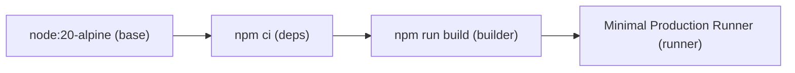

# E-Cell MITAOE — Docker Containerization Guide

## 1. Overview

The E-Cell MITAOE web application is configured for production-grade containerization utilizing **Next.js Standalone Output Mode** (`output: 'standalone'`). This multi-stage build packages only the production dependencies and necessary runtime assets into a secure, minimal Alpine Linux image.

---

## 2. Docker Architecture



### Security Hardening Features:
- **Non-Root Execution**: Runs as user `nextjs` (`UID 1001`, `GID 1001`).
- **Minimal Attack Surface**: Uses `node:20-alpine` without build tools or dev dependencies in the final runner stage.
- **Standalone Runtime**: Eliminates the complete `node_modules` directory; bundles only traced server dependencies into `.next/standalone`.
- **Telemetry Disabled**: `NEXT_TELEMETRY_DISABLED=1` set across all stages.

---

## 3. Quickstart: Building & Running with Docker

### Step 1: Build Image
```bash
docker build -t ecell-mitaoe/website:latest .
```

### Step 2: Run Container
```bash
docker run -d \
  --name ecell-website \
  -p 3000:3000 \
  --restart unless-stopped \
  ecell-mitaoe/website:latest
```

### Step 3: Verify Container Health
```bash
docker ps
curl -I http://localhost:3000/
```

---

## 4. Running with Docker Compose

A pre-configured `docker-compose.yml` is provided at the repository root with built-in healthchecks and resource limits:

```yaml
version: '3.8'

services:
  ecell-web:
    build:
      context: .
      dockerfile: Dockerfile
    container_name: ecell-mitaoe-website
    restart: unless-stopped
    ports:
      - "3000:3000"
    environment:
      - NODE_ENV=production
      - PORT=3000
      - HOSTNAME=0.0.0.0
    healthcheck:
      test: ["CMD-SHELL", "wget -qO- http://localhost:3000/ || exit 1"]
      interval: 30s
      timeout: 5s
      retries: 3
      start_period: 10s
    resources:
      limits:
        cpus: '1.0'
        memory: 1024M
      reservations:
        cpus: '0.25'
        memory: 256M
```

### Commands:
```bash
# Start in detached mode
docker compose up -d --build

# View container logs
docker compose logs -f

# Stop and remove container
docker compose down
```

